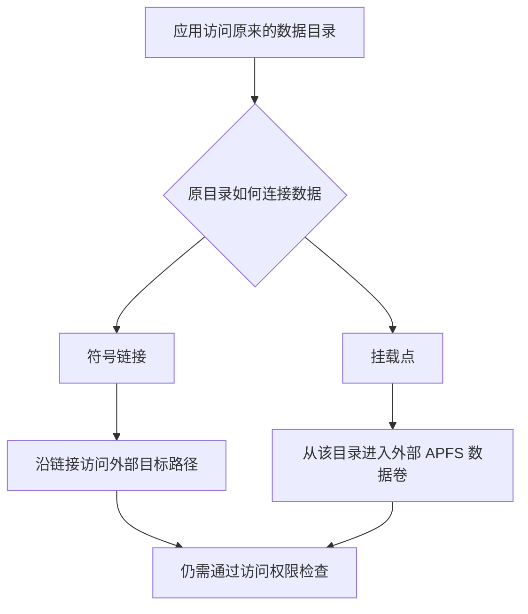

# 为什么 AppPorts 选择挂载迁移，又为什么是 APFS

**研究整理：2026 年 10 月 15 日 · 所据实验：2026 年 9 月 18 日至 10 月 14 日**

## 摘要 {#abstract}

AppPorts 希望把数据放到外置盘，同时让应用继续从原来的位置使用它。符号链接很适合许多普通目录，但在受测沙盒应用中，保留一个链接不足以恢复数据访问。挂载迁移让外部数据卷直接接到原目录，在部分保留官方签名的应用上通过了实际读写验证，因此成为符合条件的容器业务数据的默认路线。

选择原生 APFS 卷，则是另一层取舍：它能在已有 APFS 存储中增加独立可挂载的卷、共享可用空间，并减少磁盘映像带来的额外管理。映像也曾有兼容性优势，但受测 sparsebundle 在两轮拔盘后都无法挂载，削弱了把它作为默认承载方式的理由。原生 APFS 同样出现过数据库损坏，不能把这次选择解释为“已经找到不会丢数据的格式”。

本文串起不同阶段的研究，不把旧报告中的推测写成定论。当前实现说明以 AppPorts 1.9.1 开发代码的公开提交 `468c788` 为基线；历史实验保留当时的版本和限制。

## 1. 真正要保留的是应用使用数据的方式 {#problem}

把一个文件夹复制到外置盘并不难。难的是应用可能仍然访问原路径，还可能依赖原有权限、沙盒容器、数据库关系和启动时序。

最直接的做法是在原位置留下**符号链接**：它像一个指路牌，告诉系统去另一个位置找文件。对于工具缓存和适用的普通目录，这依然是 AppPorts 使用的方式。

但沙盒应用不能随意读取任意位置。系统判断的是它是否有权访问实际数据；原位置有一块指路牌，不会自动让外部目标获得相同授权。这就是最初需要验证的问题：**应用能启动、链接仍存在时，原数据是否真的可用？**

设计上还希望保留另外几件事：真实应用的开发者签名不因搬数据而改变；数据能够还原；外盘重连后可以找到同一份数据；复制或清理失败时能留下可解释的状态。只解决首次启动，而把更新、重启、换盘或恢复留给用户手动修补，不足以成为默认方案。

这些要求并非在一开始就全部验证完成。下面按研究的先后展开：先检查链接与挂载能否访问，再比较存储承载方式，随后补查重启、目录结构和物理外盘中的实际问题。

## 2. 第一组对照：链接没坏，数据仍读不到 {#symlink-experiment}

### 方法与观察指标 {#symlink-method}

2026 年 9 月 18 日，实验在 macOS 27.0（26A428）、Apple Silicon、系统完整性保护开启的环境中，对系统便签与微信 4.1.15（270099）做路径对照。使用 APFS 外部存储，并将微信官方签名与本地重签的样本分开。

选择的是应用启动时实际使用的业务数据：便签的内容目录、微信某个账户的数据目录。实验先保存原数据，然后分别比较原位置、同一容器里的另一位置、本机容器外的位置与外部卷。重定向时在原位置留下符号链接，结束后恢复原目录。

对便签，检查原有便签是否重新出现，而不是仅数一个进程；对微信，检查界面是否能读到原数据、是否提示存储权限异常，再与系统拒绝日志对照。原位置作为正常基线，容器内链接作为另一项对照，帮助判断问题是否只来自“用了链接”。

### 结果与不同变量 {#symlink-results}

观察依据是应用实际展示的内容、界面错误和系统访问日志，而非仅检查目录或进程是否存在。

| 条件 | 结果 |
| --- | --- |
| 便签数据留在原位置 | 原内容可用。 |
| 便签链接到容器内另一位置 | 原内容可用。 |
| 便签链接到本机容器外的位置 | 原内容不可用，出现访问拒绝。 |
| 便签链接到外部 APFS 卷 | 原内容不可用，出现访问拒绝。 |
| 微信官方签名、原数据留在本地 | 正常访问。 |
| 微信官方签名、数据链接到外部卷 | 应用能启动，但提示存储权限异常。 |
| 微信本地重签，分别使用本地与外部链接数据 | 均快速退出，没有完成正常访问。 |

### 为什么这影响默认方案 {#symlink-implication}

这组实验排除了两个容易误判的信号：**链接完好不等于应用有权限，应用启动不等于原内容已经加载。** 重签也没有成为该组样本的通用修复。

容器内链接成功、本机容器外链接失败，尤其有辨识力：失败条件并不只与 USB 接口或外部硬件有关。相同机器上的另一条路径，也可能落在应用当前允许范围之外。

官方签名与本地重签分开，是因为签名属于应用身份的一部分。重签后失败，即使数据仍在本地，也不能解释成“外盘太慢”或“链接断了”；同时也不能据这一次对照断言所有版本的重签都会失败。对默认数据迁移而言，更合理的方向是寻找保留原签名也能工作的接入方式。

### 这组对照的限制 {#symlink-limits}

它没有证明所有外部符号链接必然失败。不同应用可能有不同权限或例外；所以 AppPorts 保留普通目录的链接迁移，把容器数据作为需要另外处理的类别。容器内对照成功，也不能说明容器中的任意结构都可以移动；后来的[目录边界调查](/docs/blog/data-migration-boundaries)另有明确限制。

## 3. 换一种接法：把数据卷接到原目录 {#mount-experiment}

**挂载**是把一个文件系统接到某个目录。挂载后，访问这个目录就进入对应的数据卷，不再靠原目录中的符号链接跳转到另一条外部路径。



### 方法：区分挂载动作与应用访问 {#mount-method}

同一天，在相同系统和 APFS 外部存储条件下，研究备份应用实际使用的业务子目录，将副本放入独立测试卷，再让卷挂到原目录。挂载后先检查真实位置，再启动原应用，观察原内容、写入行为、授权提示和系统日志。全程保持应用原签名。

这里分别观察两个阶段。第一阶段是操作进程能否把卷接到受保护目录；第二阶段是原应用能否访问卷上的数据。这两步可能在不同进程、不同授权上下文中完成，不能用一个“成功”概括。

### 实际应用结果 {#mount-results}

| 应用 | 观察 |
| --- | --- |
| 微信 4.1.15 | 记录到授权过程，之后聊天内容可见，收发可用。 |
| Maccy | 虽有一次预检查拒绝记录，实际数据库读写可用。 |
| App Store 版小米互联服务 | 出现可移动宗卷授权提示，允许后读写可用。 |
| 系统便签 | 换卷复测仍被静默拒绝，没有得到可用结果。 |

当时未完整保存 Maccy 和小米互联服务的版本号，这是证据的限制。成功结果支持“挂载是值得采用的兼容路线”，便签的失败则说明不能承诺覆盖所有沙盒应用。

### 同一条命令，为什么换个执行者就不同 {#permissions}

实验还比较了已获相应访问授权的执行环境与脚本型后台任务。前者能够完成挂载，后者因容器路径访问权限不足而被拒绝。这说明命令文本相同，不等于执行环境相同。

迁移进程需要有权管理容器目录，原应用需要有权读取外部数据。AppPorts 已获完全磁盘访问，不代表原应用也已获得可移动宗卷权限；管理员身份也不能自动取代这些授权。

| 需要回答的问题 | 主要观察对象 | 不能用什么代替 |
| --- | --- | --- |
| 卷是否接到了目标目录 | 挂载进程、实际位置与卷身份。 | 命令返回成功或卷名看起来相同。 |
| 应用是否被允许访问 | 原应用的授权过程和实际读写。 | AppPorts 已经获得授权。 |
| 看到的是否原有内容 | 业务界面、内容与保存结果。 | 进程存在或出现一个空窗口。 |

一次预检查拒绝日志也不能单独证明最终失败：Maccy 的样本中实际访问仍可用。相反，没有弹出授权框也不能证明已经放行，便签的静默拒绝就是反例。需要把日志阶段与最终可观察结果连起来判断。

### 卷不在时，原路径仍然会产生问题 {#missing-volume}

实验还观察了未挂载时的原位置。若那里只是一个可写空目录，应用可能把新数据写回本地；外盘稍后挂回，又可能把这些新本地文件遮在下面。界面暂时空白与数据真正丢失也不是同一回事。

把未挂载入口设为不可写，可以阻止部分误写，但应用仍可能静默显示空白。后续隔离研究进一步表明，同一用户的其他进程可能持有已打开的文件、重新改权限或替换入口，所以这种保护不能被描述为不可绕过的隔离。当前恢复还需要检查落点和数据身份，不能为了尽快挂回而覆盖新内容。

### 通过范围 {#mount-limits}

因此，挂载的价值是改变数据接入方式，保留应用原有签名并争取正常授权下的访问。它不是取消系统检查的方法。第三方样本成功没有覆盖所有应用版本、目录与授权状态；便签失败也不能扩展为所有系统应用都失败。

## 4. 为什么用原生 APFS 卷 {#why-apfs}

“使用挂载”与“选择哪种文件系统承载数据”是两个问题。挂载并非 APFS 独有的能力；AppPorts 当前选择原生 APFS 卷，是为了让下面几项需求能够一起实现。

### 一个数据单元，对应一个可独立接回的卷 {#independent-volumes}

在已有 APFS 容器中，可以增加独立的数据卷，并把它接到某个业务目录。这里的 **APFS 容器**是磁盘上管理一组卷的存储空间，与应用的沙盒容器不同。

同一 APFS 容器里的卷共享可用空间，不需要为每个业务目录预先切出一块固定大小的分区。卷的独立身份又便于 AppPorts 核对它属于哪次迁移、应该接回哪个位置。这个身份仍需结合路径和记录检查，不能只凭卷名认领数据。

[Apple 的磁盘工具说明](https://support.apple.com/guide/disk-utility/add-delete-or-erase-apfs-volumes-dskua9e6a110/mac)介绍了 APFS 卷的添加与空间共享。AppPorts 当前通过系统 `diskutil apfs addVolume` 创建专用卷，不把自动抹盘或重分区作为迁移步骤。

“独立卷”也不等于“每份数据再分一块物理盘”。同一 APFS 容器可以同时承载原有文件卷与新建的数据卷，它们在需要时使用共享的剩余空间。每个数据卷又有自己的文件系统边界，可以分别挂载和还原。

这个独立性有代价：数据库和临时文件如果被拆到不同卷，跨卷操作可能与原来不同。因此卷数量并非越多越好，业务数据应按允许且稳定的单元迁移，不能为了细分占用而任意拆开相关目录。

### 为什么不能直接把同一套做法用于 exFAT {#other-filesystems}

当前实现是在**已有 APFS 容器中增加 APFS 卷**。一块只有 exFAT 文件系统的存储，并没有这层可直接增加 APFS 卷的容器。要在它上面得到同样的独立 APFS 文件系统，就需要重新安排分区、使用磁盘映像，或设计另一种管理方式。

所以，APFS 要求首先来自已经选定的实现与保全范围，而不是实验宣布“所有其他格式都不能保存应用数据”。挂载本身也不专属于 APFS。对 HFS+、NTFS 或其他文件系统采用不同后端，需要单独验证元数据、权限、卷身份、重连和恢复；现有实验没有替它们完成这份验证。

对普通目录，AppPorts 仍可采用链接迁移，但目标必须能够保全该目录需要的内容与属性。不能从“普通文件可以复制到这个盘”直接推断整个应用数据树都适用，也不能把容器的 APFS 条件扩大成所有迁移的前提。

### 数据不仅有内容，还有属性和关系 {#filesystem-semantics}

应用数据可能包含访问控制、扩展属性、符号链接、硬链接和数据库。一个面向 Mac 数据的迁移方案，不能只比较文件数量或总大小。

APFS 提供了本次实现需要的文件系统能力，但“目标是 APFS”本身也不能证明迁移正确。当前复制器仍会检查内容、可移植元数据和相关文件关系；复制过程与最终切换另有验证。[数据完整性实验](/docs/blog/data-migration-boundaries#copy-and-switch)

### 少一层需要附加、恢复和回收的映像 {#native-storage}

原生卷直接使用外置盘上的 APFS 存储。磁盘映像则在宿主文件系统里放一层映像，再从映像内部挂出文件系统。后一种方式灵活，但多了映像附加、映像内部文件系统与空间回收等管理环节。

这些理由确定了当前实现的范围：**符合条件的容器挂载迁移要求 APFS；普通应用本体和普通目录不能一并套用这个要求。** 也没有据此认定其他文件系统不可能实现类似方案，它们需要单独设计、保全验证与恢复策略。

## 5. 磁盘映像曾经有什么吸引力 {#image-alternative}

曾考虑把 APFS 文件系统装进外部存储上的磁盘映像，再把内部卷接到应用目录。这样可以探索在更多宿主格式上承载数据，而不直接要求外盘本身已经是 APFS。

实验还发现一个实际优势：便签在受测原生外部 APFS 卷上被拒绝，在受测映像中却能读写，没有观察到相同的拒绝日志。这只是当时配置的结果，但足以说明映像值得认真比较。

它的代价也需要验证。当时另一个空间回收样本中，向映像写入再删除约 5 GB 数据后，映像仍占约 5.6 GB，需要额外压缩整理才能回收空间。应用内部显示文件已删，与宿主存储已经释放空间，并不总是同一时刻发生。

可以把两条存储路径放在一起看：

```text
原生卷：应用 → 挂载的 APFS 数据卷 → 外部设备
映像：  应用 → 映像内 APFS → 映像文件或分块 → 宿主文件系统 → 外部设备
```

sparsebundle 会把映像组织为若干分块文件。应用删除映像内部文件，并不必然同时缩减宿主中的映像占用；管理程序还需要考虑回收、附加失败和内部文件系统检查。多一层本身不证明一定不可靠，但意味着需要验证更多状态，而不是只比较首次读写是否成功。

更关键的问题是：应用持续写入时，外置设备意外断开，原生卷和映像分别会怎样？

## 6. 两轮拔盘实验改变了默认选择 {#unplug-experiment}

### 条件与步骤 {#unplug-method}

2026 年 9 月 19 日，在 macOS 27.0（26A428）和一块 64 GB USB 存储上，实验比较了原生 APFS 卷与同一设备上承载 APFS 的 sparsebundle 映像。

负载持续向 SQLite 数据库写入并逐条提交，采用 WAL 模式、`synchronous=FULL`，同时定期写入普通文件。记录最近一次已提交序号，然后直接断开设备，重新连接后检查能否挂载、数据库结构和恢复结果。第二轮增加 `fullfsync` 与 `checkpoint_fullfsync` 同步请求。

第一轮两个写入进程并行运行约 12 秒后断开设备；负载每 50 次提交还写入一个 64 KB 文件。两个后端放在同一设备上，可以控制硬件差异，却也共享设备负载；这个设计用于观察故障后形态，不是独立测量它们的可靠性概率或性能排名。

恢复检查分层进行：先确认外部设备与外层卷能否访问，再尝试挂载映像，能访问数据库时才检查结构和行数。映像附加失败的样本，不能把“没有读到数据库”写成“已经知道里面每一行都丢了”。

### 两轮结果 {#unplug-results}

| 轮次 | 目标 | 拔盘前最后提交序号 | 重接结果 |
| --- | --- | --- | --- |
| 第一轮 | 原生 APFS | 7177 | 数据库报告损坏；恢复工具取回 7172 行，50 个测试文件仍在。 |
| 第一轮 | sparsebundle | 25574 | 映像无法挂载，内部文件系统检查报告超级块异常。 |
| 第二轮，增加强同步请求 | 原生 APFS | 1906 | 读取到 1905 行，数据库完整性检查通过。 |
| 第二轮，增加强同步请求 | sparsebundle | 373 | 映像仍无法挂载。 |

另有 ASIF 映像尝试，但在有效拔盘测试前中止，没有通过或失败结论。本文也不从这次中止推导 ASIF 在其他环境的能力。

第一轮 sparsebundle 的内部文件系统检查报告超级块异常，记录中的一个头部分块长度也不符合当时预期。可以确认的是该次映像未能正常挂载；没有逐一验证所有恢复工具，也没有把故障定位成某个缓存层的唯一原因。

原生 APFS 的外层卷检查正常，与其中 SQLite 数据库报告损坏并不矛盾：文件系统能访问，应用自己的数据结构仍可能不完整。第一轮使用数据库恢复工具取回记录，是恢复操作的结果，不能改写成数据库从未损坏。

### 为什么增加同步请求，还不能许诺不丢失 {#sync-and-durability}

WAL 是数据库用来记录变化的日志；`synchronous=FULL` 和第二轮的额外同步选项，要求数据库更积极地完成同步。实验增加它们，是要检查第一轮现象是否仅在较弱同步条件下出现。

第二轮中，原生卷的数据库结构正常，记录数仍少于拔盘前最后一次提交序号；映像依旧无法挂载。因此不能用某个同步开关推导“现在可以直接拔盘”。实验没有逐层观测操作系统缓存、设备控制器与介质的全部持久化过程，也没有证明某层是所有故障的共同原因。

### 结果怎样影响选型 {#unplug-limits}

两轮结果支持在当时的产品选型中保留原生 APFS、放弃把 sparsebundle 作为默认后端。它没有证明所有映像都不可恢复，也没有证明原生 APFS 只会丢最后几条记录：第一轮原生卷上的数据库已经需要恢复工具介入。

不同样本的提交数和速度不能用来直接判断持久化质量。旧记录曾用“写得快”解释缓存与落盘，本文不把这种推测当作完成了全部缓存路径验证的证据。有限样本同样无法给出任何方案的通用故障率或最大损失量。

如果目标只是让一个受测应用在首次启动时读到数据，映像确实有吸引力；如果目标还包括意外断开后的恢复与日常空间回收，就需要面对这里的额外失败。AppPorts 当时选择继续使用原生 APFS，并接受其格式范围和授权要求。这个决定基于整组条件与已知代价，而非宣称某种存储永远安全。

## 7. 选定挂载以后，问题没有结束 {#later-research}

### 重启研究的条件与方法 {#startup-method}

9 月 22–23 日的重启研究使用 macOS 27.0（26A428）、Apple Silicon、开启 FileVault 的本机和未加密 APFS 外盘，观察两个微信相关数据卷。AppPorts 已有完全磁盘访问，全程未重签应用。受控进程探测、真实重启时间线、临时卷重挂属于不同实验，不能把它们混算为相同流程的重复次数。

先比较系统级进程与已授权用户进程能否访问目标容器；再记录登录、应用启动、接回任务启动和卷实际就位的时间；最后调整任务配置，重启复查，并用临时卷安排“磁盘稍后出现”“系统已经先挂到其他位置”等条件。

### 观察结果：启动任务不等于数据已经就位 {#startup-results}

9 月 22–23 日的研究比较了 FileVault、用户会话、系统级进程与用户任务。受测环境中，解锁前目标用户数据路径尚不可用；即使以管理员身份运行，也不能跳过容器访问授权。

调整用户任务的启动配置后，一次样本中任务启动从登录后约 24.7 秒提前到 4.6 秒，两个卷实际就位从约 37 秒提前到 18 秒。这是具体样本，应用仍可能抢先启动，不能据此承诺固定等待时间。

另一项发现是，卷已经被系统挂到别处时，指定新挂载位置的命令可能返回成功，却未将卷接到原目录。当前实现因此检查实际挂载路径与卷身份，等待卷变化并按需重试，而不只相信命令退出码。[重启与自动接回实验](/docs/blog/why-mount-and-apfs#startup-method)

| 探测或方案 | 观察结果 | 对设计的含义 |
| --- | --- | --- |
| FileVault 解锁前挂到用户容器 | 受测环境中的目标数据路径尚不可用。 | 不是把任务调度得更早就能完成。 |
| 系统级进程直接挂载 | 管理员身份仍受容器访问授权限制。 | 不能用提权替代正确授权上下文。 |
| 系统级进程触发已授权用户任务 | 用户会话存在时可行，会话未建立时失败。 | 仍依赖会话，并引入额外系统组件。 |
| 系统固定挂载表 | 当时 UUID 形式失败，设备编号形式可挂载。 | 设备编号重连后可能变化，固定条目也不能处理全部授权与时序。 |
| 卷已在系统自动位置挂载 | 命令可以成功，却没有移到原目录。 | 需要核对实际位置，并按身份处理已有挂载。 |
| 数据卷延迟出现 | 卷变化后再尝试可完成相应重挂。 | 等待真实事件比假定一个固定延时更符合实际。 |

固定挂载表中的 UUID 失败只属于当时配置，不能概括成 macOS 永远不支持 UUID。临时卷的事件响应也不是一次完整开机时间。后续重启仍出现应用先于数据就位，不能因为某次启动更快就写成竞态已经消失。

### 当前接回为什么需要位置与身份两项确认 {#startup-current}

卷重新连接后，系统分配的设备编号可能变化，所以不能把旧编号当作永久身份。卷 UUID 提供更稳定的关联，但仍需结合实际路径、记录和对象检查，不能只凭一个可复制的卷名认领数据。

当前接回循环在卷变化后重新核对，等待时释放操作锁，并保留有限重试与兜底检查。它确认的是数据是否真正接到预期目录；后台任务的退出码或进程状态只是其中一个信号。

如果未挂载的底层目录已经出现新文件，恢复不能简单覆盖它来追求快速上线。原件、外置活动数据、未完成操作之间的关系需要先弄清。AppPorts 不能自动替应用合并两份独立产生的新数据。

### 重启实验的适用范围 {#startup-limits}

这些样本未覆盖所有硬件、FileVault 状态、登录项目与系统版本，也没有证明自动接回永远先于原应用。实际使用仍应先连接外盘、确认“已挂载”，再打开依赖数据的应用；移动或更新 AppPorts 后打开一次，以便核对后台任务的程序位置。曾测试的系统守护进程与固定挂载表继续保存在[历史功能归档](/docs/archive/mount-experiments)。

### 目录：能接入外部卷，不等于任意层级都能搬 {#structure}

10 月 1 日企业微信调查发现，`Data/tmp` 被替换为另一个文件系统后，会触发启动前的容器结构检查。另一些业务子目录可以通过，但跨卷原子移动、删除挂载根等操作仍有边界。

因此 APFS 格式正确、卷已挂载、应用权限齐全，也不能放开整个容器。AppPorts 保护精确结构节点，额外检查父子迁移冲突与应用兼容范围。完整调查见[为什么有些数据目录不能迁移](/docs/blog/data-migration-boundaries)。

### 实机：镜像里通过的实现，也可能在物理盘上失败 {#physical-validation}

10 月 13–14 日的后续记录补上了真实物理外盘与应用流程的验证。中间实现曾为了设置卷根所有权，改用更底层的建卷方式；隔离磁盘映像可用，真实外盘却遇到裸设备访问权限问题。

另一些失败来自卷根的普通文件权限。完整磁盘访问没有自动让普通用户获得该卷根的写权限，不能把所有失败都归因于用户没有授权。

当前普通数据卷回到系统建卷方式，并明确采用 `noowners` 挂载语义，检查实际可写性。它表示按相应的卷所有权语义访问，不会自动跳过沙盒或隐私授权。已经明确记录严格所有权契约的历史操作，仍按其原记录处理。

这一段演变回答了“为什么只在磁盘映像里通过还不够”。隔离映像便于控制输入、注入失败和重复比较；物理设备的创建权限、既有所有权语义与真实文件属性，却可能与它不同。两类验证需要互相补充。

后续实机还发现，系统为真实附件添加的管理标签可能改变。如果把所有标签变化都当成业务内容变化，就会在数据已经可用时一直拒绝清理旧副本。当前对特定系统管理标签和可移植应用属性分别处理，继续检查内容、普通访问控制和应用属性；这不等于忽略所有元数据。

10 月 13 日，AppPorts 1.9.1 build 27 的真实微信流程完成了迁出、使用后原位还原、再次迁出，独立文件内容比较与各自正确时间点的清单一致。此前 build 26 的一次清理因系统管理标签变化而暂停，修复后才完成，不能把这段过程改写成最初就一次通过。10 月 14 日另一轮多应用验收中，Maccy 2.7.1 的流程也验证了数据写入、卷卸载后自动接回和还原，该轮包含 build 30 的补充测试；最后一段还原后原入口界面确认存在记录限制，不能据文件一致补写为已完成。

这些是当时安装构建的历史结果；本文对 `468c788` 做的是代码核对，没有重演实机流程。它们扩展了实机证据，但没有补齐真实断电、所有登录时序、Intel 和其他系统版本，也没有验证每个应用的全部业务。后续成功不能抹掉此前失败。[当前建卷与挂载实现](https://github.com/wzh4869/AppPorts/blob/468c7889f367281543c96e9c8f40515c37b65403/AppPorts/Utils/DiskUtility.swift)

## 8. 当前选择保留了什么，又接受了什么代价 {#tradeoffs}

| 方案 | 它解决得好的问题 | 当前取舍 |
| --- | --- | --- |
| 普通目录使用符号链接 | 简单，适合许多工具和普通数据目录。 | 继续使用；不据此保证沙盒应用能访问外部目标。 |
| 为链接访问而自动重签应用 | 曾作为改变访问条件的探索方向。 | 当前迁移与签名分离；保留历史说明，不把替换真实应用身份作为默认前提。 |
| 原生 APFS 卷挂到业务目录 | 独立卷、共享空间，受测应用可在原签名下读写。 | 用于符合条件的容器业务数据，承担授权、接回与恢复管理。 |
| APFS 磁盘映像 | 可以探索更多宿主格式，受测便签有访问优势。 | sparsebundle 的拔盘与空间回收结果不满足当时默认方案的要求；保留研究记录。 |
| 系统挂载表或系统守护进程 | 希望简化固定挂载或提前完成接回。 | 没有解决所有解锁、身份、授权和时序问题，不要求用户安装这套实验方案。 |

当前挂载迁移要求**未加密 APFS**，这是 AppPorts 现有实现范围，绝不表示 APFS 本身不支持加密。新建的数据卷不会自动继承另一卷的密码；在没有完整密码管理和自动解锁方案时，不能因为原存储加密，就默默新建一个未加密的数据卷继续迁移。[存储准备与加密说明](/docs/storage-guide#encrypted-drives)

这条路线还需要维护卷身份、正常弹出、登录接回、失败恢复与复制验证。它增加了检查时间和实现复杂度，换来的是对数据去向和操作结果更明确的确认。当前流程不靠关闭完整性检查来承诺接近旧版的速度。

## 9. 对日常使用意味着什么 {#daily-use}

准备迁移时，先看自己迁的是应用本体、普通目录，还是容器业务数据。只有后一类需要遵守这里的专用 APFS 卷条件。

迁移后仍应检查原内容和保存功能；重启或重新连接外盘后，先确认数据已挂载，再打开依赖它的应用。使用结束时正常弹出设备，并让备份覆盖实际存放数据的外置盘。

AppPorts 选择挂载与 APFS，是在已验证的兼容性、空间管理、数据检查和维护成本之间作出的选择。它没有改变“设备可以断开、应用可能有自己的限制、重要数据需要备份”这些事实。

## 10. 资料与研究边界 {#references}

本文综合早期 AppPorts 实验文档、项目研究与实现记录，以及后续实机报告。正文只保留实验条件、方法、汇总结果和局限；原始个人路径、账户、聊天内容、私有诊断包与内部讨论不进入公开文章。本次整理没有重新运行拔盘或真实数据迁移。

- [符号链接实验](/docs/blog/why-mount-and-apfs#symlink-experiment)：2026 年 9 月 18 日，便签与微信的路径、签名对照。
- [挂载与授权实验](/docs/blog/why-mount-and-apfs#mount-experiment)：同日多应用访问与两类权限对照。
- [意外断开实验](/docs/blog/why-mount-and-apfs#unplug-experiment)：9 月 19 日两轮原生卷与 sparsebundle 比较，含失败和中止项。
- [重启与自动接回实验](/docs/blog/why-mount-and-apfs#startup-method)：9 月 22–23 日授权上下文、启动时序与实际挂载位置。
- [Apple：添加、删除或抹掉 APFS 宗卷](https://support.apple.com/guide/disk-utility/add-delete-or-erase-apfs-volumes-dskua9e6a110/mac)：APFS 卷与共享空间的公开说明。
- [AppPorts 挂载预检](https://github.com/wzh4869/AppPorts/blob/468c7889f367281543c96e9c8f40515c37b65403/AppPorts/Utils/MountMigrationPreflight.swift)与[迁移工作流](https://github.com/wzh4869/AppPorts/blob/468c7889f367281543c96e9c8f40515c37b65403/AppPorts/Services/DataMigrationWorkflow.swift)：核对当前条件及迁移、签名分离。
- [历史挂载方案归档](/docs/archive/mount-experiments)与[旧版签名流程归档](/docs/archive/data-signing)：保留未采用和已停用方式的来由。

继续阅读：[迁移数据的步骤](/docs/datamigrae/operation) · [为什么有些数据目录不能迁移](/docs/blog/data-migration-boundaries) · [名词解释](/docs/glossary)
