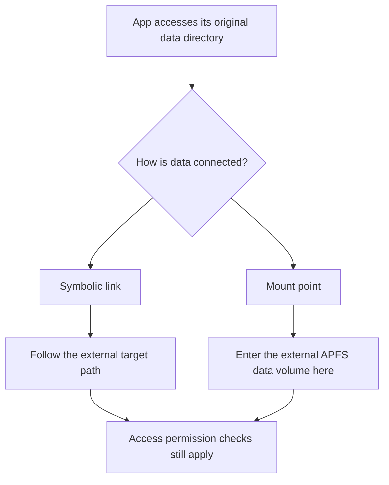

# Why AppPorts chose mount migration and APFS

**Compiled: October 15, 2026 · Experiments: September 18–October 14, 2026**

## Abstract {#abstract}

AppPorts aims to store data externally while letting apps continue using its original location. Symbolic links work well for many ordinary directories, but an intact link did not restore data access for the sandboxed apps tested here. Mount migration attaches an external data volume directly at the original directory. Actual reads and writes worked for some apps retaining their official signatures, making this the default approach for eligible container business data.

Native APFS volumes are a separate choice: they provide independently mountable volumes within existing APFS storage, share available space, and avoid additional disk-image management. Images offered compatibility advantages, but the tested sparsebundles could not be mounted after either of two unplug tests. Native APFS also suffered database corruption; this is not a claim to have found a format that cannot lose data.

This article connects several stages of research without treating earlier hypotheses as established facts. Descriptions of the implementation use public commit `468c788` of the AppPorts 1.9.1 development code. Historical tests retain their original versions and limitations.

## 1. Preserving how an app uses its data {#problem}

Copying a folder externally is straightforward. The difficulty is that an app may still access its original path and depend on existing permissions, sandbox containers, database relationships, and startup timing.

The simplest approach leaves a **symbolic link** at the original path: a sign directing the system elsewhere. AppPorts still uses this for tool caches and suitable ordinary directories.

Sandboxed apps cannot read arbitrary locations. The system checks access to the actual data; a sign at the original path does not automatically grant the external target the same authorization. The first question was therefore: **when the app starts and the link exists, is the original data actually usable?**

The design also aims to preserve the real app's developer signature, allow restoration, find the same data after reconnection, and leave an understandable state if copying or cleanup fails. A default method cannot stop at first launch and leave updates, restarts, drive changes, and recovery to manual repair.

These requirements were not all verified at the outset. The research first tested access through links and mounts, compared storage backends, and then investigated restarting, directory structure, and physical external drives.

## 2. First comparison: an intact link, inaccessible data {#symlink-experiment}

### Method and observations {#symlink-method}

On September 18, 2026, path comparisons used Stickies and WeChat 4.1.15 (270099) on macOS 27.0 (26A428), Apple Silicon, with System Integrity Protection enabled. External storage was APFS. Officially signed and locally re-signed WeChat samples were kept separate.

The selected directories contained data used during startup: Stickies content and one WeChat account's data. After preserving originals, the experiment compared the original location, another location inside the same container, a local location outside the container, and an external volume. Redirected cases left a symlink at the original path; the original directory was restored afterward.

For Stickies, success meant the original notes reappeared, not merely that a process existed. For WeChat, observations included original content, storage-permission errors, and system denial logs. The original path was the baseline, and an in-container link helped test whether merely using a link caused the problem.

### Results and variables {#symlink-results}

Evidence came from displayed content, UI errors, and access logs, rather than just directory or process existence.

| Condition | Result |
| --- | --- |
| Stickies data at its original location | Original content available. |
| Stickies linked elsewhere inside its container | Original content available. |
| Stickies linked to a local path outside its container | Original content unavailable; access denied. |
| Stickies linked to external APFS | Original content unavailable; access denied. |
| Officially signed WeChat with local original data | Normal access. |
| Officially signed WeChat linked to external data | App started but reported a storage-permission error. |
| Locally re-signed WeChat with local data and, separately, external linked data | Both exited quickly without normal access. |

### Implications for the default {#symlink-implication}

Two misleading signals were ruled out: **an intact link does not establish permission, and a running app does not establish that original content loaded.** Re-signing was not a general repair for these samples.

The successful in-container link and failed local out-of-container link were particularly useful: the failure was not limited to USB hardware. Another path on the same Mac could also fall outside the app's allowed scope.

Signatures were treated separately because they contribute to app identity. A re-signed app failing with local data cannot be explained simply as a slow external drive or broken link. Nor does this one comparison establish failure for all re-signed app versions. For default data migration, it supported seeking access that preserves the original signature.

### Limits of the comparison {#symlink-limits}

The experiment did not prove that all external symlinks fail. Apps may have different permissions or exceptions. AppPorts retains link migration for ordinary directories and handles container data separately. Successful in-container links also do not mean arbitrary container structures can move; the later [directory-boundary investigation](/docs/blog/data-migration-boundaries) established further restrictions.

## 3. Another connection: mount the volume at the original directory {#mount-experiment}

**Mounting** attaches a filesystem at a directory. Access then enters that volume directly, rather than following a symlink to a different external path.



### Method: separate mounting from app access {#mount-method}

On the same day and system, using external APFS storage, the experiment backed up actual business-data subdirectories, copied them to independent test volumes, and mounted those volumes at the original paths. After verifying the actual mount location, the original app was opened to observe content, writes, authorization prompts, and system logs. Original signatures remained unchanged.

There were two stages: whether the operating process could attach the volume at the protected directory, and whether the original app could access the data. Different processes and authorization contexts can perform these stages; one success flag cannot describe both.

### Real-app results {#mount-results}

| App | Observation |
| --- | --- |
| WeChat 4.1.15 | An authorization process was recorded; chat content then appeared and sending/receiving worked. |
| Maccy | Actual database reads and writes worked despite one preflight denial record. |
| App Store Xiaomi Interconnectivity | A removable-volume permission prompt appeared; access worked after approval. |
| Stickies | A repeat with another volume was still silently denied; no usable result. |

The exact Maccy and Xiaomi versions were not fully recorded, limiting the evidence. Successful cases supported mounting as a useful compatibility approach; Stickies showed that universal sandbox-app coverage could not be promised.

### Why the same command behaves differently under another process {#permissions}

The experiment compared an appropriately authorized environment with a script-based background task. The first mounted successfully; the latter was denied access to the container path. Identical command text does not establish identical execution conditions.

The migration process needs permission to manage the container, while the original app needs access to external data. Full Disk Access for AppPorts does not grant the original app removable-volume access. Administrator identity does not automatically replace either authorization.

| Question | Main evidence | Insufficient substitute |
| --- | --- | --- |
| Is the volume attached at the target directory? | Mount process, actual location, and volume identity. | Command success or a familiar volume name. |
| Can the app access it? | The original app's authorization and actual reads/writes. | AppPorts already having permission. |
| Is this the original content? | Business UI, content, and saved results. | A process or an empty window. |

One preflight denial cannot by itself prove final failure: Maccy still worked. Conversely, no permission prompt does not prove access was granted: Stickies was silently denied. Logs must be connected to their stage and the final observable result.

### The original path can still cause problems while unmounted {#missing-volume}

If the unmounted path is a writable empty directory, an app may create new local data. A later mount can hide those files underneath it. A temporarily empty interface is also different from actual data loss.

Making the unmounted entry unwritable can prevent some accidental writes, yet the app may silently display an empty state. Later isolated research showed that other processes under the same user may retain open files, change permissions again, or replace the entry. This protection is not an unbreakable isolation boundary. Recovery must check destination and data identity, rather than overwrite new content merely to remount quickly.

### Scope of success {#mount-limits}

Mounting changes the data connection while preserving the app's signature and seeking access through normal authorization. It does not remove system checks. Successful third-party samples do not cover every app version, directory, or permission state; the Stickies failure does not establish failure for all system apps.

## 4. Why native APFS volumes? {#why-apfs}

Choosing mounting and choosing its storage backend are different decisions. Mounting is not unique to APFS. Native APFS volumes were selected to satisfy the following requirements together.

### One data unit, one independently reconnectable volume {#independent-volumes}

An existing APFS container can hold an additional data volume mounted at a business-data directory. An **APFS container** is disk storage managing a group of volumes, distinct from an app sandbox container.

Volumes in the same APFS container share available space, so every data directory need not receive a fixed-size partition. Independent volume identity helps AppPorts check which migration a volume belongs to and where it should return. Paths and records still need checking; a volume name alone cannot claim data.

[Apple's Disk Utility guide](https://support.apple.com/guide/disk-utility/add-delete-or-erase-apfs-volumes-dskua9e6a110/mac) explains adding APFS volumes and shared space. AppPorts creates dedicated volumes with `diskutil apfs addVolume`; automatic erasing or repartitioning is not part of migration.

An independent volume does not require a separate physical disk. Existing file volumes and new data volumes can share remaining space in the same container. Each data volume has its own filesystem boundary and can be mounted and restored independently.

That independence has costs. Splitting databases and temporary files across volumes can change cross-volume operations. More volumes are not inherently better; move permitted, stable business-data units rather than arbitrarily splitting related directories to obtain finer size categories.

### Why the same implementation cannot simply use exFAT {#other-filesystems}

The implementation **adds an APFS volume to an existing APFS container**. Storage containing only exFAT has no such container. Obtaining an equivalent independent APFS filesystem would require repartitioning, a disk image, or another management design.

The requirement therefore follows from the chosen implementation and preservation scope. It does not mean experiments established that other formats cannot store app data. Mounting is not APFS-exclusive. A backend for HFS+, NTFS, or another filesystem would require separate validation of metadata, permissions, identity, reconnection, and recovery; these experiments did not provide it.

Ordinary directories may still use link migration, provided the destination preserves their required contents and attributes. Copying an ordinary file successfully does not establish suitability for an entire app-data tree. The container requirement is not a prerequisite for every migration.

### Data includes attributes and relationships {#filesystem-semantics}

App data may include access controls, extended attributes, symbolic links, hard links, and databases. Migrating Mac data requires more than comparing file counts or total sizes.

APFS provides capabilities needed by this implementation, but an APFS target alone does not establish correctness. The copier still checks content, portable metadata, and relevant file relationships; copying and final switching are validated separately. See the [data-integrity experiments](/docs/blog/data-migration-boundaries#copy-and-switch).

### One less image layer to attach, recover, and reclaim {#native-storage}

Native volumes use the external device's APFS storage directly. Images add a file layer in the host filesystem, from which an internal filesystem is attached. Images are flexible but introduce attachment, internal-filesystem, and space-reclamation management.

The scope is therefore specific: **eligible container mount migration requires APFS; ordinary apps and directories do not automatically inherit that requirement.** Similar approaches on other filesystems remain possible in principle, but need their own design, preservation checks, and recovery strategy.

## 5. Why disk images were attractive {#image-alternative}

An APFS filesystem inside an image on external storage could be mounted at the app directory. This offered a way to explore more host formats without requiring the external drive itself to be APFS.

There was a practical compatibility advantage: Stickies was denied access on the tested native external APFS volume, yet read and wrote successfully in the tested image without the same denial logs. This was specific to that configuration, but justified comparing images seriously.

Space reclamation introduced a cost. In another sample, writing and deleting about 5 GB left the image occupying roughly 5.6 GB until additional compaction. Deleting files inside an app and reclaiming space on the host need not happen together.

```text
Native: app → mounted APFS data volume → external device
Image:  app → APFS inside image → image file/bands → host filesystem → external device
```

A sparsebundle stores an image as band files. Deleting an internal file need not shrink its host footprint immediately. Management must also address reclamation, attachment failures, and internal filesystem checks. An extra layer does not inherently prove unreliability, but creates more states to validate than first-use reads and writes.

A more important question followed: what happens to each backend if the external device disconnects while an app is writing?

## 6. Two unplug tests changed the default choice {#unplug-experiment}

### Conditions and procedure {#unplug-method}

On September 19, 2026, tests on macOS 27.0 (26A428) compared a native APFS volume with an APFS sparsebundle on the same 64 GB USB device.

A continuous workload committed one SQLite row at a time, using WAL and `synchronous=FULL`, and periodically wrote ordinary files. The last committed sequence number was recorded before physically disconnecting the device. After reconnection, checks covered mounting, database structure, and recovery. Round two added `fullfsync` and `checkpoint_fullfsync` requests.

In round one, both writers ran concurrently for about 12 seconds before unplugging. Each wrote a 64 KB file every 50 commits. Sharing a device controlled hardware differences but also shared its workload. The design observed failure forms; it did not independently measure reliability probabilities or rank performance.

Recovery checks proceeded in layers: device and outer-volume access, image attachment, then database structure and row counts where accessible. If an image could not attach, “the database could not be read” did not establish that every row inside had been lost.

### Results {#unplug-results}

| Round | Target | Last committed sequence | After reconnection |
| --- | --- | --- | --- |
| First | Native APFS | 7177 | Database reported corruption; recovery retrieved 7172 rows, and 50 test files remained. |
| First | sparsebundle | 25574 | Image would not mount; internal filesystem check reported a superblock error. |
| Second, stronger sync requests | Native APFS | 1906 | 1905 rows readable; database integrity check passed. |
| Second, stronger sync requests | sparsebundle | 373 | Image still would not mount. |

An ASIF attempt stopped before a valid unplug test. It has no pass/fail conclusion, and that interruption establishes nothing about ASIF in other environments.

The first sparsebundle's filesystem check reported a superblock problem; one recorded header band also had an unexpected length. What is established is failure to mount normally. Every recovery tool was not tested, and no single cache layer was identified as the exclusive cause.

A healthy outer APFS filesystem and a corrupted SQLite database are compatible observations: accessible files can still contain incomplete application structures. Recovering rows with a database tool does not mean the database was never damaged.

### Why stronger synchronization is not a no-loss promise {#sync-and-durability}

WAL records database changes. `synchronous=FULL` and the extra second-round options request more aggressive synchronization. They were added to test whether the first-round behavior appeared only under weaker synchronization.

In round two, the native database structure was intact but its row count remained below the last recorded commit number. The image still could not mount. No sync switch therefore justifies unplugging without ejecting. The experiment did not observe every persistence stage in OS caches, device controllers, and media, or establish one common cause for all failures.

### How the results affected the choice {#unplug-limits}

The two rounds supported retaining native APFS and rejecting sparsebundle as the default backend at that time. They did not prove every image unrecoverable or native APFS limited to losing a few final records: the first native database required recovery tools.

Commit counts and speed cannot directly establish durability. Earlier notes speculated about caches from faster writes; this article does not treat that as verification of the entire cache path. Small samples cannot establish a general failure rate or maximum data loss for either approach.

For first-launch access alone, images were attractive. For unexpected disconnection and routine space reclamation, their additional failures mattered. AppPorts continued with native APFS while accepting its format and authorization requirements, based on the combined evidence and costs rather than a claim of permanent storage safety.

## 7. Choosing mounts did not end the investigation {#later-research}

### Restart-study conditions and method {#startup-method}

The September 22–23 restart study used macOS 27.0 (26A428), Apple Silicon, FileVault enabled, an unencrypted APFS external drive, and two WeChat-related data volumes. AppPorts had Full Disk Access; apps were never re-signed. Controlled process probes, real restart timelines, and temporary-volume remounts were different experiments, not repeated runs of one identical procedure.

First, system and authorized user processes were compared for container access. Login, app launch, remount-task start, and actual volume readiness were then timed. Task configuration was adjusted and checked after restarting. Temporary volumes also simulated late disk arrival and a volume already mounted elsewhere by macOS.

### A task starting does not mean data is ready {#startup-results}

In the tested FileVault environment, the user data path was unavailable before unlock. Administrator execution still could not bypass container authorization.

After changing user-task startup configuration, one sample improved task start from about 24.7 seconds after login to 4.6 seconds, and readiness of both volumes from about 37 seconds to 18 seconds. These are individual observations, not guaranteed waiting times; apps could still start first.

A command specifying a new mount location could also return success when macOS had already mounted the volume elsewhere, without moving it to the original directory. The implementation therefore checks actual path and identity, waits for volume changes, and retries where needed instead of trusting the exit code alone. See the [restart experiment](/docs/blog/why-mount-and-apfs#startup-method).

| Probe or approach | Observation | Design implication |
| --- | --- | --- |
| Mount into a user container before FileVault unlock | Target data path unavailable. | Earlier scheduling alone cannot solve it. |
| Direct mount by a system process | Administrator identity still faced container authorization. | Privilege elevation is not a substitute for the right authorization context. |
| System process starts an authorized user task | Worked with a user session; failed before it existed. | Still session-dependent, with additional system components. |
| Fixed system mount table | UUID form failed in that setup; device-identifier form mounted. | Device identifiers can change; fixed entries do not solve all timing and authorization. |
| Volume already at an automatic system mount point | Command could succeed without moving it. | Check the actual location and handle existing mounts by identity. |
| Data volume appears late | Retrying after a volume-change event completed the relevant remount. | Real events are more useful than assuming a fixed delay. |

The UUID result applies to that configuration, not all macOS UUID mounts. Temporary-volume event response is not a complete boot time. Later restarts still showed apps starting before data; a faster sample did not eliminate the race.

### Why reconnection checks both location and identity {#startup-current}

Device identifiers can change on reconnection, so an old identifier is not permanent identity. A volume UUID offers a more stable association, but must still be checked with the actual path, records, and object. A copyable volume name cannot claim ownership of data.

The current remount loop rechecks after volume changes, releases the operation lock while waiting, and retains bounded retries and fallback checks. It verifies that data is actually attached at the expected directory; process state and exit code are only supporting signals.

If new files exist in the underlying unmounted directory, recovery cannot overwrite them simply to bring data online quickly. Originals, active external data, and unfinished operations must first be distinguished. AppPorts cannot automatically merge two independently updated datasets for an app.

### Limits of restart testing {#startup-limits}

These samples do not cover all hardware, FileVault states, login items, or OS versions. They do not prove remounting always precedes app launch. Connect the drive, confirm “Mounted,” then open dependent apps. Open AppPorts once after moving or updating it so the background task's executable location can be checked. Tested system-daemon and fixed-table approaches remain in the [archive](/docs/archive/mount-experiments).

### A mountable volume does not make every directory movable {#structure}

The October 1 WeCom investigation found that replacing `Data/tmp` with another filesystem triggered a container-structure check before startup. Some business subdirectories passed, but cross-volume atomic moves and deletion of mount roots still had limits.

Correct APFS format, a mounted volume, and sufficient app permissions do not justify moving the whole container. AppPorts protects exact structural nodes and checks parent/child conflicts and app compatibility. See [why some data directories cannot be migrated](/docs/blog/data-migration-boundaries).

### Success in an image can still fail on a physical drive {#physical-validation}

October 13–14 records added physical-drive and real-app workflow validation. An intermediate implementation used lower-level volume creation to set root ownership. It worked in isolated images but encountered raw-device permission failures on physical storage.

Other failures involved ordinary volume-root permissions. Full Disk Access did not automatically give an ordinary user write access to that root. Not every failure could be blamed on missing privacy authorization.

Ordinary data volumes now use system volume creation again, explicitly adopt `noowners` mount semantics, and check actual writability. This concerns volume ownership semantics; it does not bypass sandbox or privacy authorization. Historical operations with explicit strict-ownership contracts retain those recorded rules.

Isolated images make inputs, injected failures, and comparisons easier to control. Physical creation permissions, existing ownership semantics, and real file attributes can differ. Both forms of validation are needed.

Real-device testing also found that system-managed labels on actual attachments can change. Treating every such change as a business-content change could indefinitely block cleanup despite usable data. The implementation distinguishes specific system-managed labels from portable app attributes while still checking content, ordinary access controls, and app attributes. It does not ignore all metadata.

On October 13, AppPorts 1.9.1 build 27 completed a real WeChat migration, in-place restoration after use, and another migration. Independent content comparisons matched manifests from the appropriate points in time. A previous build 26 cleanup had paused because system-managed labels changed; it completed only after a fix. This was not a first-attempt success. On October 14, a multi-app acceptance round also checked writes, automatic remount after unmount, and restoration with Maccy 2.7.1, including supplementary build 30 testing. The final original-entry UI confirmation after restoration has a recording limitation; file equality does not fill that gap.

These are historical results from the installed builds. The review of `468c788` inspected code and did not rerun the physical workflows. The later evidence does not cover real power failure, every login sequence, Intel, other OS versions, or every app workflow. Later successes do not erase earlier failures. See the [volume creation and mount implementation](https://github.com/wzh4869/AppPorts/blob/468c7889f367281543c96e9c8f40515c37b65403/AppPorts/Utils/DiskUtility.swift).

## 8. Benefits retained and costs accepted {#tradeoffs}

| Approach | Strength | Current decision |
| --- | --- | --- |
| Symbolic links for ordinary directories | Simple and suitable for many tool and ordinary data folders. | Retained, without promising sandbox access to external targets. |
| Automatic app re-signing for link access | Explored as a way to change access conditions. | Migration and signing are separate; replacing app identity is not a default prerequisite. Historical guidance remains. |
| Native APFS volume at a business-data directory | Independent volumes, shared space, and observed access under original signatures. | Used for eligible container data, with authorization, reconnection, and recovery management. |
| APFS disk image | More possible host formats and a Stickies access advantage in the tested setup. | sparsebundle unplug and reclamation results did not meet the requirements for the default; research remains documented. |
| System mount table or daemon | Aimed to simplify fixed mounting or complete it earlier. | Did not solve all unlock, identity, authorization, and timing issues; users need not install these experimental components. |

Current mount migration requires **unencrypted APFS**. This is an implementation boundary, not a claim that APFS lacks encryption. New data volumes do not automatically inherit another volume's password. Without complete password management and automatic unlocking, AppPorts cannot silently create an unencrypted data volume just because the original storage is encrypted. See [storage and encryption](/docs/storage-guide#encrypted-drives).

This approach also requires identity tracking, proper ejection, login remounting, failure recovery, and copy verification. It adds checks and implementation complexity in exchange for clearer confirmation of data location and operation results. The current workflow does not disable integrity checks to promise old-version speed.

## 9. What this means in daily use {#daily-use}

First distinguish apps, ordinary directories, and container business data. Only the last category requires the dedicated APFS-volume conditions described here.

After migration, check original content and saving. After restarting or reconnecting, confirm the data is mounted before opening dependent apps. Eject properly afterward and include the external storage holding actual data in your backups.

Mounting and APFS reflect a choice among verified compatibility, space management, data checking, and maintenance costs. Devices can still disconnect, apps can impose their own limits, and important data still needs backups.

## 10. Sources and research boundaries {#references}

This article draws on early AppPorts experiment documents, project research and implementation records, and later real-device reports. It publishes conditions, methods, aggregate results, and limitations. Personal paths, accounts, chat content, private diagnostic packages, and internal discussions are excluded. This compilation did not rerun unplug tests or real-data migrations.

- [Symbolic-link experiment](/docs/blog/why-mount-and-apfs#symlink-experiment): September 18, 2026; Stickies and WeChat path/signature comparisons.
- [Mounting and authorization](/docs/blog/why-mount-and-apfs#mount-experiment): same-day app access and the two permission contexts.
- [Unexpected disconnection](/docs/blog/why-mount-and-apfs#unplug-experiment): September 19; two native/sparsebundle rounds, including failures and the aborted attempt.
- [Restart and remounting](/docs/blog/why-mount-and-apfs#startup-method): September 22–23; authorization, timing, and actual mount locations.
- [Apple: add, delete, or erase APFS volumes](https://support.apple.com/guide/disk-utility/add-delete-or-erase-apfs-volumes-dskua9e6a110/mac): volume and space-sharing documentation.
- [AppPorts mount preflight](https://github.com/wzh4869/AppPorts/blob/468c7889f367281543c96e9c8f40515c37b65403/AppPorts/Utils/MountMigrationPreflight.swift) and [migration workflow](https://github.com/wzh4869/AppPorts/blob/468c7889f367281543c96e9c8f40515c37b65403/AppPorts/Services/DataMigrationWorkflow.swift): implementation conditions and separation of migration from signing.
- [Historical mount approaches](/docs/archive/mount-experiments) and [legacy signing](/docs/archive/data-signing): reasons behind unadopted and retired methods.

Continue: [migrate data](/docs/datamigrae/operation) · [directory boundaries](/docs/blog/data-migration-boundaries) · [glossary](/docs/glossary)
