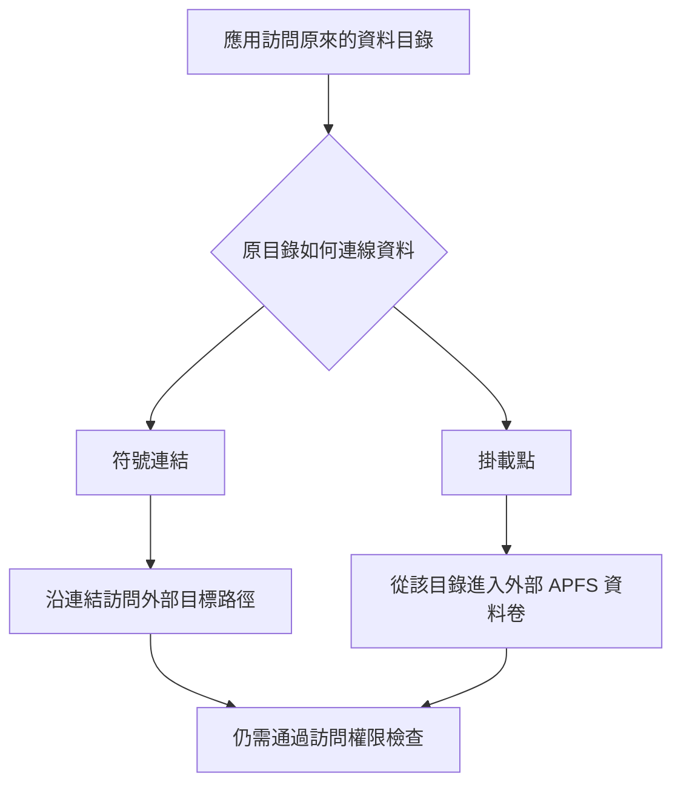

# 為什麼 AppPorts 選擇掛載遷移，又為什麼是 APFS

**研究整理：2026 年 10 月 15 日 · 所據實驗：2026 年 9 月 18 日至 10 月 14 日**

## 摘要 {#abstract}

AppPorts 希望把資料放到外接磁碟，同時讓應用繼續從原來的位置使用它。符號連結很適合許多普通目錄，但在受測沙盒應用中，保留一個連結不足以恢復資料訪問。掛載遷移讓外部資料卷直接接到原目錄，在部分保留官方簽名的應用上通過了實際讀寫驗證，因此成為符合條件的容器業務資料的預設路線。

選擇原生 APFS 卷，則是另一層取捨：它能在已有 APFS 儲存中增加獨立可掛載的卷、共享可用空間，並減少磁碟映像帶來的額外管理。映像也曾有相容性優勢，但受測 sparsebundle 在兩輪拔盤後都無法掛載，削弱了把它作為預設承載方式的理由。原生 APFS 同樣出現過資料庫損壞，不能把這次選擇解釋為“已經找到不會丟資料的格式”。

本文串起不同階段的研究，不把舊報告中的推測寫成定論。當前實現說明以 AppPorts 1.9.1 開發程式碼的公開提交 `468c788` 為基線；歷史實驗保留當時的版本和限制。

## 1. 真正要保留的是應用使用資料的方式 {#problem}

把一個資料夾複製到外接磁碟並不難。難的是應用可能仍然訪問原路徑，還可能依賴原有權限、沙盒容器、資料庫關係和啟動時序。

最直接的做法是在原位置留下**符號連結**：它像一個指路牌，告訴系統去另一個位置找檔案。對於工具快取和適用的普通目錄，這依然是 AppPorts 使用的方式。

但沙盒應用不能隨意讀取任意位置。系統判斷的是它是否有權訪問實際資料；原位置有一塊指路牌，不會自動讓外部目標獲得相同授權。這就是最初需要驗證的問題：**應用能啟動、連結仍存在時，原資料是否真的可用？**

設計上還希望保留另外幾件事：真實應用的開發者簽名不因搬資料而改變；資料能夠還原；外接磁碟重連後可以找到同一份資料；複製或清理失敗時能留下可解釋的狀態。只解決首次啟動，而把更新、重啟、換盤或恢復留給使用者手動修補，不足以成為預設方案。

這些要求並非在一開始就全部驗證完成。下面按研究的先後展開：先檢查連結與掛載能否訪問，再比較儲存承載方式，隨後補查重啟、目錄結構和物理外接磁碟中的實際問題。

## 2. 第一組對照：連結沒壞，資料仍讀不到 {#symlink-experiment}

### 方法與觀察指標 {#symlink-method}

2026 年 9 月 18 日，實驗在 macOS 27.0（26A428）、Apple Silicon、系統完整性保護開啟的環境中，對系統便條紙與微信 4.1.15（270099）做路徑對照。使用 APFS 外部儲存，並將微信官方簽名與本地重簽的樣本分開。

選擇的是應用啟動時實際使用的業務資料：便條紙的內容目錄、微信某個帳戶的資料目錄。實驗先儲存原資料，然後分別比較原位置、同一容器裡的另一位置、本機容器外的位置與外部卷。重定向時在原位置留下符號連結，結束後恢復原目錄。

對便條紙，檢查原有便條紙是否重新出現，而不是僅數一個程序；對微信，檢查介面是否能讀到原資料、是否提示儲存權限異常，再與系統拒絕日誌對照。原位置作為正常基線，容器內連結作為另一項對照，幫助判斷問題是否只來自“用了連結”。

### 結果與不同變數 {#symlink-results}

觀察依據是應用實際展示的內容、介面錯誤和系統訪問日誌，而非僅檢查目錄或程序是否存在。

| 條件 | 結果 |
| --- | --- |
| 便條紙資料留在原位置 | 原內容可用。 |
| 便條紙連結到容器內另一位置 | 原內容可用。 |
| 便條紙連結到本機容器外的位置 | 原內容不可用，出現訪問拒絕。 |
| 便條紙連結到外部 APFS 卷 | 原內容不可用，出現訪問拒絕。 |
| 微信官方簽名、原資料留在本地 | 正常訪問。 |
| 微信官方簽名、資料連結到外部卷 | 應用能啟動，但提示儲存權限異常。 |
| 微信本地重簽，分別使用本地與外部連結資料 | 均快速退出，沒有完成正常訪問。 |

### 為什麼這影響預設方案 {#symlink-implication}

這組實驗排除了兩個容易誤判的訊號：**連結完好不等於應用有權限，應用啟動不等於原內容已經載入。** 重簽也沒有成為該組樣本的通用修復。

容器內連結成功、本機容器外連結失敗，尤其有辨識力：失敗條件並不只與 USB 介面或外部硬體有關。相同機器上的另一條路徑，也可能落在應用當前允許範圍之外。

官方簽名與本地重簽分開，是因為簽名屬於應用身份的一部分。重簽後失敗，即使資料仍在本地，也不能解釋成“外接磁碟太慢”或“連結斷了”；同時也不能據這一次對照斷言所有版本的重簽都會失敗。對預設資料遷移而言，更合理的方向是尋找保留原簽名也能工作的接入方式。

### 這組對照的限制 {#symlink-limits}

它沒有證明所有外部符號連結必然失敗。不同應用可能有不同權限或例外；所以 AppPorts 保留普通目錄的連結遷移，把容器資料作為需要另外處理的類別。容器內對照成功，也不能說明容器中的任意結構都可以移動；後來的[目錄邊界調查](/docs/blog/data-migration-boundaries)另有明確限制。

## 3. 換一種接法：把資料卷接到原目錄 {#mount-experiment}

**掛載**是把一個檔案系統接到某個目錄。掛載後，訪問這個目錄就進入對應的資料卷，不再靠原目錄中的符號連結跳轉到另一條外部路徑。



### 方法：區分掛載動作與應用訪問 {#mount-method}

同一天，在相同系統和 APFS 外部儲存條件下，研究備份應用實際使用的業務子目錄，將副本放入獨立測試卷，再讓卷掛到原目錄。掛載後先檢查真實位置，再啟動原應用，觀察原內容、寫入行為、授權提示和系統日誌。全程保持應用原簽名。

這裡分別觀察兩個階段。第一階段是操作程序能否把卷接到受保護目錄；第二階段是原應用能否訪問卷上的資料。這兩步可能在不同程序、不同授權上下文中完成，不能用一個“成功”概括。

### 實際應用結果 {#mount-results}

| 應用 | 觀察 |
| --- | --- |
| 微信 4.1.15 | 記錄到授權過程，之後聊天內容可見，收發可用。 |
| Maccy | 雖有一次預檢查拒絕記錄，實際資料庫讀寫可用。 |
| App Store 版小米互聯服務 | 出現可移動宗卷授權提示，允許後讀寫可用。 |
| 系統便條紙 | 換卷複測仍被靜默拒絕，沒有得到可用結果。 |

當時未完整儲存 Maccy 和小米互聯服務的版本號，這是證據的限制。成功結果支援“掛載是值得採用的相容路線”，便條紙的失敗則說明不能承諾覆蓋所有沙盒應用。

### 同一條命令，為什麼換個執行者就不同 {#permissions}

實驗還比較了已獲相應訪問授權的執行環境與指令碼型背景任務。前者能夠完成掛載，後者因容器路徑訪問權限不足而被拒絕。這說明命令文字相同，不等於執行環境相同。

遷移程序需要有權管理容器目錄，原應用需要有權讀取外部資料。AppPorts 已獲完全磁碟訪問，不代表原應用也已獲得可移動宗卷權限；管理員身份也不能自動取代這些授權。

| 需要回答的問題 | 主要觀察物件 | 不能用什麼代替 |
| --- | --- | --- |
| 卷是否接到了目標目錄 | 掛載程序、實際位置與卷身份。 | 命令返回成功或卷名看起來相同。 |
| 應用是否被允許訪問 | 原應用的授權過程和實際讀寫。 | AppPorts 已經獲得授權。 |
| 看到的是否原有內容 | 業務介面、內容與儲存結果。 | 程序存在或出現一個空視窗。 |

一次預檢查拒絕日誌也不能單獨證明最終失敗：Maccy 的樣本中實際訪問仍可用。相反，沒有彈出授權框也不能證明已經放行，便條紙的靜默拒絕就是反例。需要把日誌階段與最終可觀察結果連起來判斷。

### 卷不在時，原路徑仍然會產生問題 {#missing-volume}

實驗還觀察了未掛載時的原位置。若那裡只是一個可寫空目錄，應用可能把新資料寫回本地；外接磁碟稍後掛回，又可能把這些新本地檔案遮在下面。介面暫時空白與資料真正丟失也不是同一回事。

把未掛載入口設為不可寫，可以阻止部分誤寫，但應用仍可能靜默顯示空白。後續隔離研究進一步表明，同一使用者的其他程序可能持有已開啟的檔案、重新改權限或替換入口，所以這種保護不能被描述為不可繞過的隔離。當前恢復還需要檢查落點和資料身份，不能為了儘快掛回而覆蓋新內容。

### 通過範圍 {#mount-limits}

因此，掛載的價值是改變資料接入方式，保留應用原有簽名並爭取正常授權下的訪問。它不是取消系統檢查的方法。第三方樣本成功沒有覆蓋所有應用版本、目錄與授權狀態；便條紙失敗也不能推論為所有系統應用都失敗。

## 4. 為什麼用原生 APFS 卷 {#why-apfs}

“使用掛載”與“選擇哪種檔案系統承載資料”是兩個問題。掛載並非 APFS 獨有的能力；AppPorts 當前選擇原生 APFS 卷，是為了讓下面幾項需求能夠一起實現。

### 一個資料單元，對應一個可獨立接回的卷 {#independent-volumes}

在已有 APFS 容器中，可以增加獨立的資料卷，並把它接到某個業務目錄。這裡的 **APFS 容器**是磁碟上管理一組卷的儲存空間，與應用的沙盒容器不同。

同一 APFS 容器裡的卷共享可用空間，不需要為每個業務目錄預先切出一塊固定大小的分割槽。卷的獨立身份又便於 AppPorts 核對它屬於哪次遷移、應該接回哪個位置。這個身份仍需結合路徑和記錄檢查，不能只憑卷名認領資料。

[Apple 的磁碟工具說明](https://support.apple.com/guide/disk-utility/add-delete-or-erase-apfs-volumes-dskua9e6a110/mac)介紹了 APFS 卷的新增與空間共享。AppPorts 當前透過系統 `diskutil apfs addVolume` 建立專用卷，不把自動抹盤或重新分割作為遷移步驟。

“獨立卷”也不等於“每份資料再分一塊物理盤”。同一 APFS 容器可以同時承載原有檔案卷與新建的資料卷，它們在需要時使用共享的剩餘空間。每個資料卷又有自己的檔案系統邊界，可以分別掛載和還原。

這個獨立性有代價：資料庫和臨時檔案如果被拆到不同卷，跨卷操作可能與原來不同。因此卷數量並非越多越好，業務資料應按允許且穩定的單元遷移，不能為了細分佔用而任意拆開相關目錄。

### 為什麼不能直接把同一套做法用於 exFAT {#other-filesystems}

當前實現是在**已有 APFS 容器中增加 APFS 卷**。一塊只有 exFAT 檔案系統的儲存，並沒有這層可直接增加 APFS 卷的容器。要在它上面得到同樣的獨立 APFS 檔案系統，就需要重新安排分割槽、使用磁碟映像，或設計另一種管理方式。

所以，APFS 要求首先來自已經選定的實現與保全範圍，而不是實驗宣佈“所有其他格式都不能儲存應用資料”。掛載本身也不專屬於 APFS。對 HFS+、NTFS 或其他檔案系統採用不同後端，需要單獨驗證後設資料、權限、卷身份、重連和恢復；現有實驗沒有替它們完成這份驗證。

對普通目錄，AppPorts 仍可採用連結遷移，但目標必須能夠保全該目錄需要的內容與屬性。不能從“普通檔案可以複製到這個盤”直接推斷整個應用資料樹都適用，也不能把容器的 APFS 條件擴大成所有遷移的前提。

### 資料不僅有內容，還有屬性和關係 {#filesystem-semantics}

應用資料可能包含訪問控制、延伸屬性、符號連結、硬式連結和資料庫。一個面向 Mac 資料的遷移方案，不能只比較檔案數量或總大小。

APFS 提供了本次實現需要的檔案系統能力，但“目標是 APFS”本身也不能證明遷移正確。當前複製器仍會檢查內容、可移植後設資料和相關檔案關係；複製過程與最終切換另有驗證。[資料完整性實驗](/docs/blog/data-migration-boundaries#copy-and-switch)

### 少一層需要附加、恢復和回收的映像 {#native-storage}

原生卷直接使用外接磁碟上的 APFS 儲存。磁碟映像則在宿主檔案系統裡放一層映像，再從映像內部掛出檔案系統。後一種方式靈活，但多了映像附加、映像內部檔案系統與空間回收等管理環節。

這些理由確定了當前實現的範圍：**符合條件的容器掛載遷移要求 APFS；普通應用本體和普通目錄不能一併套用這個要求。** 也沒有據此認定其他檔案系統不可能實現類似方案，它們需要單獨設計、保全驗證與恢復策略。

## 5. 磁碟映像曾經有什麼吸引力 {#image-alternative}

曾考慮把 APFS 檔案系統裝進外部儲存上的磁碟映像，再把內部卷接到應用目錄。這樣可以探索在更多宿主格式上承載資料，而不直接要求外接磁碟本身已經是 APFS。

實驗還發現一個實際優勢：便條紙在受測原生外部 APFS 卷上被拒絕，在受測映像中卻能讀寫，沒有觀察到相同的拒絕日誌。這只是當時配置的結果，但足以說明映像值得認真比較。

它的代價也需要驗證。當時另一個空間回收樣本中，向映像寫入再刪除約 5 GB 資料後，映像仍佔約 5.6 GB，需要額外壓縮整理才能回收空間。應用內部顯示檔案已刪，與宿主儲存已經釋放空間，並不總是同一時刻發生。

可以把兩條儲存路徑放在一起看：

```text
原生卷：應用 → 掛載的 APFS 資料卷 → 外部裝置
映像：  應用 → 映像內 APFS → 映像檔案或分塊 → 宿主檔案系統 → 外部裝置
```

sparsebundle 會把映像組織為若干分塊檔案。應用刪除映像內部檔案，並不必然同時縮減宿主中的映像佔用；管理程式還需要考慮回收、附加失敗和內部檔案系統檢查。多一層本身不證明一定不可靠，但意味著需要驗證更多狀態，而不是隻比較首次讀寫是否成功。

更關鍵的問題是：應用持續寫入時，外接裝置意外斷開，原生卷和映像分別會怎樣？

## 6. 兩輪拔盤實驗改變了預設選擇 {#unplug-experiment}

### 條件與步驟 {#unplug-method}

2026 年 9 月 19 日，在 macOS 27.0（26A428）和一塊 64 GB USB 儲存上，實驗比較了原生 APFS 卷與同一裝置上承載 APFS 的 sparsebundle 映像。

負載持續向 SQLite 資料庫寫入並逐條提交，採用 WAL 模式、`synchronous=FULL`，同時定期寫入普通檔案。記錄最近一次已提交序號，然後直接斷開裝置，重新連線後檢查能否掛載、資料庫結構和恢復結果。第二輪增加 `fullfsync` 與 `checkpoint_fullfsync` 同步請求。

第一輪兩個寫入程序並行執行約 12 秒後斷開裝置；負載每 50 次提交還寫入一個 64 KB 檔案。兩個後端放在同一裝置上，可以控制硬體差異，卻也共享裝置負載；這個設計用於觀察故障後形態，不是獨立測量它們的可靠性機率或效能排名。

恢復檢查分層進行：先確認外部裝置與外層卷能否訪問，再嘗試掛載映像，能訪問資料庫時才檢查結構和行數。映像附加失敗的樣本，不能把“沒有讀到資料庫”寫成“已經知道裡面每一行都丟了”。

### 兩輪結果 {#unplug-results}

| 輪次 | 目標 | 拔盤前最後提交序號 | 重接結果 |
| --- | --- | --- | --- |
| 第一輪 | 原生 APFS | 7177 | 資料庫報告損壞；恢復工具取回 7172 行，50 個測試檔案仍在。 |
| 第一輪 | sparsebundle | 25574 | 映像無法掛載，內部檔案系統檢查報告超級塊異常。 |
| 第二輪，增加強同步請求 | 原生 APFS | 1906 | 讀取到 1905 行，資料庫完整性檢查通過。 |
| 第二輪，增加強同步請求 | sparsebundle | 373 | 映像仍無法掛載。 |

另有 ASIF 映像嘗試，但在有效拔盤測試前中止，沒有通過或失敗結論。本文也不從這次中止推導 ASIF 在其他環境的能力。

第一輪 sparsebundle 的內部檔案系統檢查報告超級塊異常，記錄中的一個頭部分塊長度也不符合當時預期。可以確認的是該次映像未能正常掛載；沒有逐一驗證所有恢復工具，也沒有把故障定位成某個快取層的唯一原因。

原生 APFS 的外層卷檢查正常，與其中 SQLite 資料庫報告損壞並不矛盾：檔案系統能訪問，應用自己的資料結構仍可能不完整。第一輪使用資料庫恢復工具取回記錄，是恢復操作的結果，不能改寫成資料庫從未損壞。

### 為什麼增加同步請求，還不能許諾不丟失 {#sync-and-durability}

WAL 是資料庫用來記錄變化的日誌；`synchronous=FULL` 和第二輪的額外同步選項，要求資料庫更積極地完成同步。實驗增加它們，是要檢查第一輪現象是否僅在較弱同步條件下出現。

第二輪中，原生卷的資料庫結構正常，記錄數仍少於拔盤前最後一次提交序號；映像依舊無法掛載。因此不能用某個同步開關推導“現在可以直接拔盤”。實驗沒有逐層觀測作業系統快取、裝置控制器與介質的全部持久化過程，也沒有證明某層是所有故障的共同原因。

### 結果怎樣影響選型 {#unplug-limits}

兩輪結果支援在當時的產品選型中保留原生 APFS、放棄把 sparsebundle 作為預設後端。它沒有證明所有映像都不可恢復，也沒有證明原生 APFS 只會丟最後幾條記錄：第一輪原生卷上的資料庫已經需要恢復工具介入。

不同樣本的提交數和速度不能用來直接判斷持久化質量。舊記錄曾用“寫得快”解釋快取與落盤，本文不把這種推測當作完成了全部快取路徑驗證的證據。有限樣本同樣無法給出任何方案的通用故障率或最大損失量。

如果目標只是讓一個受測應用在首次啟動時讀到資料，映像確實有吸引力；如果目標還包括意外斷開後的恢復與日常空間回收，就需要面對這裡的額外失敗。AppPorts 當時選擇繼續使用原生 APFS，並接受其格式範圍和授權要求。這個決定基於整組條件與已知代價，而非宣稱某種儲存永遠安全。

## 7. 選定掛載以後，問題沒有結束 {#later-research}

### 重啟研究的條件與方法 {#startup-method}

9 月 22–23 日的重啟研究使用 macOS 27.0（26A428）、Apple Silicon、開啟 FileVault 的本機和未加密 APFS 外接磁碟，觀察兩個微信相關資料卷。AppPorts 已有完全磁碟訪問，全程未重簽應用。受控程序探測、真實重啟時間線、臨時卷重掛屬於不同實驗，不能把它們混算為相同流程的重複次數。

先比較系統級程序與已授權使用者程序能否訪問目標容器；再記錄登入、應用啟動、接回任務啟動和卷實際就位的時間；最後調整任務配置，重啟複查，並用臨時卷安排“磁碟稍後出現”“系統已經先掛到其他位置”等條件。

### 觀察結果：啟動任務不等於資料已經就位 {#startup-results}

9 月 22–23 日的研究比較了 FileVault、使用者會話、系統級程序與使用者任務。受測環境中，解鎖前目標使用者資料路徑尚不可用；即使以管理員身份執行，也不能跳過容器訪問授權。

調整使用者任務的啟動配置後，一次樣本中任務啟動從登入後約 24.7 秒提前到 4.6 秒，兩個卷實際就位從約 37 秒提前到 18 秒。這是具體樣本，應用仍可能搶先啟動，不能據此承諾固定等待時間。

另一項發現是，卷已經被系統掛到別處時，指定新掛載位置的命令可能返回成功，卻未將卷接到原目錄。當前實現因此檢查實際掛載路徑與卷身份，等待卷變化並按需重試，而不只相信命令退出碼。[重啟與自動接回實驗](/docs/blog/why-mount-and-apfs#startup-method)

| 探測或方案 | 觀察結果 | 對設計的含義 |
| --- | --- | --- |
| FileVault 解鎖前掛到使用者容器 | 受測環境中的目標資料路徑尚不可用。 | 不是把任務排程得更早就能完成。 |
| 系統級程序直接掛載 | 管理員身份仍受容器訪問授權限制。 | 不能用提權替代正確授權上下文。 |
| 系統級程序觸發已授權使用者任務 | 使用者會話存在時可行，會話未建立時失敗。 | 仍依賴會話，並引入額外系統元件。 |
| 系統固定掛載表 | 當時 UUID 形式失敗，裝置編號形式可掛載。 | 裝置編號重連後可能變化，固定條目也不能處理全部授權與時序。 |
| 卷已在系統自動位置掛載 | 命令可以成功，卻沒有移到原目錄。 | 需要核對實際位置，並按身份處理已有掛載。 |
| 資料卷延遲出現 | 卷變化後再嘗試可完成相應重掛。 | 等待真實事件比假定一個固定延時更符合實際。 |

固定掛載表中的 UUID 失敗只屬於當時配置，不能概括成 macOS 永遠不支援 UUID。臨時卷的事件響應也不是一次完整開機時間。後續重啟仍出現應用先於資料就位，不能因為某次啟動更快就寫成競態已經消失。

### 當前接回為什麼需要位置與身份兩項確認 {#startup-current}

卷重新連線後，系統分配的裝置編號可能變化，所以不能把舊編號當作永久身份。卷 UUID 提供更穩定的關聯，但仍需結合實際路徑、記錄和物件檢查，不能只憑一個可複製的卷名認領資料。

當前接回迴圈在卷變化後重新核對，等待時釋放操作鎖，並保留有限重試與兜底檢查。它確認的是資料是否真正接到預期目錄；背景任務的退出碼或程序狀態只是其中一個訊號。

如果未掛載的底層目錄已經出現新檔案，恢復不能簡單覆蓋它來追求快速上線。原件、外接活動資料、未完成操作之間的關係需要先弄清。AppPorts 不能自動替應用合併兩份獨立產生的新資料。

### 重啟實驗的適用範圍 {#startup-limits}

這些樣本未覆蓋所有硬體、FileVault 狀態、登入專案與系統版本，也沒有證明自動接回永遠先於原應用。實際使用仍應先連線外接磁碟、確認“已掛載”，再開啟依賴資料的應用；移動或更新 AppPorts 後開啟一次，以便核對背景任務的程式位置。曾測試的系統系統背景服務與固定掛載表繼續儲存在[歷史功能歸檔](/docs/archive/mount-experiments)。

### 目錄：能接入外部卷，不等於任意層級都能搬 {#structure}

10 月 1 日企業微信調查發現，`Data/tmp` 被替換為另一個檔案系統後，會觸發啟動前的容器結構檢查。另一些業務子目錄可以通過，但跨卷原子移動、刪除掛載根等操作仍有邊界。

因此 APFS 格式正確、卷已掛載、應用權限齊全，也不能放開整個容器。AppPorts 保護精確結構節點，額外檢查父子遷移衝突與應用相容範圍。完整調查見[為什麼有些資料目錄不能遷移](/docs/blog/data-migration-boundaries)。

### 實機：映象裡通過的實現，也可能在物理盤上失敗 {#physical-validation}

10 月 13–14 日的後續記錄補上了真實物理外接磁碟與應用流程的驗證。中間實現曾為了設定卷根所有權，改用更底層的建卷方式；隔離磁碟映像可用，真實外接磁碟卻遇到裸裝置訪問權限問題。

另一些失敗來自卷根的普通檔案權限。完整磁碟訪問沒有自動讓普通使用者獲得該卷根的寫權限，不能把所有失敗都歸因於使用者沒有授權。

當前普通資料卷回到系統建卷方式，並明確採用 `noowners` 掛載語義，檢查實際可寫性。它表示按相應的卷所有權語義訪問，不會自動跳過沙盒或隱私授權。已經明確記錄嚴格所有權契約的歷史操作，仍按其原記錄處理。

這一段演變回答了“為什麼只在磁碟映像裡通過還不夠”。隔離映像便於控制輸入、注入失敗和重複比較；物理裝置的建立權限、既有所有權語義與真實檔案屬性，卻可能與它不同。兩類驗證需要互相補充。

後續實機還發現，系統為真實附件新增的管理標籤可能改變。如果把所有標籤變化都當成業務內容變化，就會在資料已經可用時一直拒絕清理舊副本。當前對特定系統管理標籤和可移植應用屬性分別處理，繼續檢查內容、普通訪問控制和應用屬性；這不等於忽略所有後設資料。

10 月 13 日，AppPorts 1.9.1 build 27 的真實微信流程完成了遷出、使用後原位還原、再次遷出，獨立檔案內容比較與各自正確時間點的清單一致。此前 build 26 的一次清理因系統管理標籤變化而暫停，修復後才完成，不能把這段過程改寫成最初就一次通過。10 月 14 日另一輪多應用驗收中，Maccy 2.7.1 的流程也驗證了資料寫入、卷卸載後自動接回和還原，該輪包含 build 30 的補充測試；最後一段還原後原入口介面確認存在記錄限制，不能據檔案一致補寫為已完成。

這些是當時安裝構建的歷史結果；本文對 `468c788` 做的是程式碼核對，沒有重演實機流程。它們補充了實機證據，但沒有補齊真實斷電、所有登入時序、Intel 和其他系統版本，也沒有驗證每個應用的全部業務。後續成功不能抹掉此前失敗。[當前建卷與掛載實現](https://github.com/wzh4869/AppPorts/blob/468c7889f367281543c96e9c8f40515c37b65403/AppPorts/Utils/DiskUtility.swift)

## 8. 當前選擇保留了什麼，又接受了什麼代價 {#tradeoffs}

| 方案 | 它解決得好的問題 | 當前取捨 |
| --- | --- | --- |
| 普通目錄使用符號連結 | 簡單，適合許多工具和普通資料目錄。 | 繼續使用；不據此保證沙盒應用能訪問外部目標。 |
| 為連結訪問而自動重簽應用 | 曾作為改變訪問條件的探索方向。 | 當前遷移與簽名分離；保留歷史說明，不把替換真實應用身份作為預設前提。 |
| 原生 APFS 卷掛到業務目錄 | 獨立卷、共享空間，受測應用可在原簽名下讀寫。 | 用於符合條件的容器業務資料，承擔授權、接回與恢復管理。 |
| APFS 磁碟映像 | 可以探索更多宿主格式，受測便條紙有訪問優勢。 | sparsebundle 的拔盤與空間回收結果不滿足當時預設方案的要求；保留研究記錄。 |
| 系統掛載表或系統系統背景服務 | 希望簡化固定掛載或提前完成接回。 | 沒有解決所有解鎖、身份、授權和時序問題，不要求使用者安裝這套實驗方案。 |

在本文固定的 `468c788` 程式碼基準中，掛載遷移要求**未加密 APFS**，這是當時的實現範圍，絕不表示 APFS 本身不支援加密。新建的資料卷不會自動繼承另一卷的密碼；在沒有完整密碼管理和自動解鎖方案時，不能因為原儲存加密，就默默新建一個未加密的資料卷繼續遷移。[儲存準備與加密說明](/docs/storage-guide#encrypted-drives)

這條路線還需要維護卷身份、正常彈出、登入接回、失敗恢復與複製驗證。它增加了檢查時間和實現複雜度，換來的是對資料去向和操作結果更明確的確認。當前流程不靠關閉完整性檢查來承諾接近舊版的速度。

2.0.0 已新增獨立加密資料卷宗與可選本機鑰匙圈儲存，操作見上述儲存說明；這不改變本文歷史實驗的條件與結果。

## 9. 對日常使用意味著什麼 {#daily-use}

準備遷移時，先看自己遷的是應用本體、普通目錄，還是容器業務資料。只有後一類需要遵守這裡的專用 APFS 卷條件。

遷移後仍應檢查原內容和儲存功能；重啟或重新連線外接磁碟後，先確認資料已掛載，再開啟依賴它的應用。使用結束時正常彈出裝置，並讓備份覆蓋實際存放資料的外接磁碟。

AppPorts 選擇掛載與 APFS，是在已驗證的相容性、空間管理、資料檢查和維護成本之間作出的選擇。它沒有改變“裝置可以斷開、應用可能有自己的限制、重要資料需要備份”這些事實。

## 10. 資料與研究邊界 {#references}

本文綜合早期 AppPorts 實驗文件、專案研究與實現記錄，以及後續實機報告。正文只保留實驗條件、方法、彙總結果和侷限；原始個人路徑、帳戶、聊天內容、私有診斷包與內部討論不進入公開文章。本次整理沒有重新執行拔盤或真實資料遷移。

- [符號連結實驗](/docs/blog/why-mount-and-apfs#symlink-experiment)：2026 年 9 月 18 日，便條紙與微信的路徑、簽名對照。
- [掛載與授權實驗](/docs/blog/why-mount-and-apfs#mount-experiment)：同日多應用訪問與兩類權限對照。
- [意外斷開實驗](/docs/blog/why-mount-and-apfs#unplug-experiment)：9 月 19 日兩輪原生卷與 sparsebundle 比較，含失敗和中止項。
- [重啟與自動接回實驗](/docs/blog/why-mount-and-apfs#startup-method)：9 月 22–23 日授權上下文、啟動時序與實際掛載位置。
- [Apple：新增、刪除或抹掉 APFS 宗卷](https://support.apple.com/guide/disk-utility/add-delete-or-erase-apfs-volumes-dskua9e6a110/mac)：APFS 卷與共享空間的公開說明。
- [AppPorts 掛載預檢](https://github.com/wzh4869/AppPorts/blob/468c7889f367281543c96e9c8f40515c37b65403/AppPorts/Utils/MountMigrationPreflight.swift)與[遷移工作流](https://github.com/wzh4869/AppPorts/blob/468c7889f367281543c96e9c8f40515c37b65403/AppPorts/Services/DataMigrationWorkflow.swift)：核對當前條件及遷移、簽名分離。
- [歷史掛載方案歸檔](/docs/archive/mount-experiments)與[舊版簽名流程歸檔](/docs/archive/data-signing)：保留未採用和已停用方式的來由。

繼續閱讀：[遷移資料的步驟](/docs/datamigrae/operation) · [為什麼有些資料目錄不能遷移](/docs/blog/data-migration-boundaries) · [名詞解釋](/docs/glossary)
